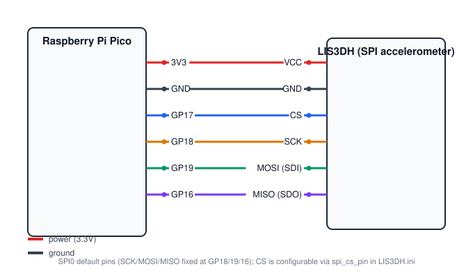
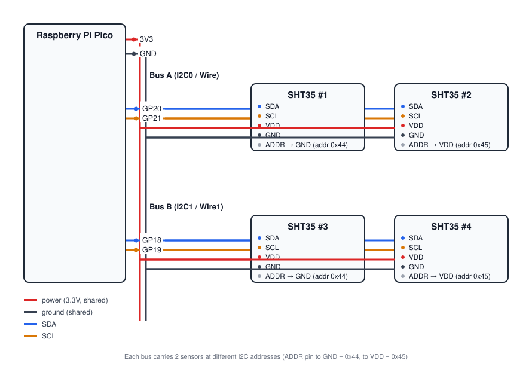
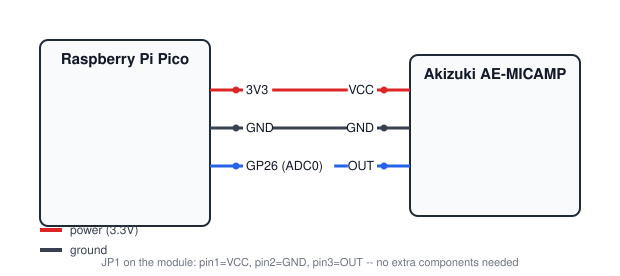

# sensor-bridge

[](https://github.com/tominagahirotaka/sensor-bridge/actions/workflows/tests.yml)

A Python/PyQt5 research instrumentation framework for acquiring, visualizing,
and analyzing sensor data streamed from a Raspberry Pi Pico / Pico W over
USB serial. It pairs a lightweight Arduino firmware layer (one sketch per
supported sensor board) with two desktop applications: `get.py` for live
acquisition and `plot.py` for post-hoc visualization and signal processing.

## Why sensor-bridge

Most hobbyist Arduino-to-PC serial examples send data as ASCII text
(`Serial.println(...)`), which is simple to read but too slow for
high-rate, timing-sensitive measurements. sensor-bridge instead:

- times each sample **on the Pico itself**, in microseconds, at the moment
  of acquisition -- not on the host when the packet happens to arrive, so
  sampling intervals are not distorted by PC-side OS scheduling or GUI
  redraw jitter;
- streams samples as **fixed-width binary frames** (`struct`-packed, one
  `struct.Struct` compiled once per connection) rather than delimited text,
  avoiding both the parsing overhead and the ambiguity of text framing;
- keeps live acquisition (`get.py`) and post-hoc analysis (`plot.py`) as
  separate applications sharing the same underlying data model, so a
  recording can be re-opened, re-filtered, and re-exported at any time
  without re-running the experiment.

Measured on real recorded hardware data (LIS3DH accelerometer, several
output-data-rate settings), sampling-interval jitter stayed under 1%
coefficient of variation. This measurement has not yet been written up as
a repeatable script/notebook in this repository; doing so is a TODO
before citing the number in the paper.

## Supported hardware

Each row below is a `<name>.ini` / `<name>_jp.ini` pair (English / Japanese
UI) plus a matching sketch under `firmware/Arduino/`.

| Board config | Sensor / purpose |
|---|---|
| `LIS3DH` | LIS3DH 3-axis accelerometer (SPI) |
| `SHT35` | Sensirion SHT35 temperature & humidity (I2C) |
| `Analog` | Generic analog input (e.g. a custom photoplethysmography front-end read via the Pico's ADC) |
| `DPG_X95840W` | X95840W digital-potentiometer-based device, with live peak (heart-rate-style) detection |
| `DPG_X95840W_LIS3DHx2` | DPG_X95840W combined with two LIS3DH accelerometers |
| `default` | Fallback generic analog config |

New boards are added by pairing a new `<name>.ini` with a new Arduino
sketch; see [Adding a new sensor board](#adding-a-new-sensor-board) below.

### Wireless-capable boards (Pico W / Pico 2 / Pico 2 W)

Prebuilt `.uf2`s for all four board variants (Pico, the RP2350-based
Pico 2, and the wireless-capable Pico W / Pico 2 W) are included under
`firmware/` for every board config, built from the same sketches with no
source changes -- GP26/ADC0 is the same GPIO on RP2040 and RP2350 (`A0`
is defined identically for both in the arduino-pico core, confirmed from
its variant headers). Compiling for four targets is mechanical, but
*running correctly* is a separate claim that has to be checked on real
hardware board by board; the two aren't the same guarantee:

| Firmware | Pico | Pico 2 | Pico W | Pico 2 W |
|---|---|---|---|---|
| `Analog` | verified | verified | compiled, not yet hardware-tested | verified |
| `DPG_X95840W` | verified | compiled, not yet hardware-tested | compiled, not yet hardware-tested | verified |
| `DPG_X95840W_LIS3DHx2` | verified | compiled, not yet hardware-tested | compiled, not yet hardware-tested | compiled, not yet hardware-tested |
| `LIS3DH_SPI` | verified | compiled, not yet hardware-tested | verified | compiled, not yet hardware-tested |
| `i2cSHT35` | verified | compiled, not yet hardware-tested | compiled, not yet hardware-tested | compiled, not yet hardware-tested |

"Verified" means flashed to that real board and exercised through
`get.py`/`plot.py` during development. The "compiled, not yet
hardware-tested" cells build cleanly (correct FQBN, no compile errors)
but haven't been flashed to that specific board yet -- treat them as a
reasonable starting point, not a guarantee, until confirmed. Real-world
hardware testing of these is planned as follow-up work.

Whether a front end actually works on a *wireless* board, though, also
depends on the circuit, not just the chip -- this is a separate question
from "does it compile":

- **X95840W PPG front end** and **LIS3DH accelerometer (SPI)** were
  verified on real Pico W and Pico 2 W hardware and work identically to
  a plain Pico/Pico 2.
- **A commercial microphone-amplifier kit** (`Analog.ini`; Akizuki
  Denshi AE-MICAMP -- an electret condenser mic driving an OPA344
  op-amp stage at 100x gain, single-supply 2.5-5V, run here from the
  Pico's own 3.3V rail with its OUT pin wired directly to GP26/ADC0 and
  GND common, no additional external circuit; the same kit used for the
  paper's audio example) does not: on both Pico W and Pico 2 W it shows
  sustained ADC clipping with no correlation to actual sound,
  reproducible across multiple boards and wiring re-checks, while the
  identical circuit on a plain Pico/Pico 2 is clean. The mechanism is
  not conclusively identified. One plausible, unverified contributor:
  the amplifier's supply is drawn from the same 3.3V rail that also
  powers the board's onboard wireless chip (CYW43439), so radio-driven
  current transients on that shared rail could couple into the
  amplifier's output -- and the kit's headroom is already reduced by
  running it at 3.3V rather than its datasheet-recommended 5V, which
  the manufacturer's own documentation notes can cause clipping on its
  own. This hasn't been measured directly, and other explanations (e.g.
  proximity to the antenna, PCB layout) are possible. A separately
  regulated/filtered supply for the amplifier, and/or shielding the
  input line, would be reasonable things to try, but neither has been.

## Wiring diagrams

Wires are labeled by function (VCC/GND/SDA/SCL/...), not by a specific
breakout board's physical pin position, so these apply regardless of
exactly which revision of a module you have -- match the label on the
diagram to the label printed on your board. Generated by
[`scripts/generate_wiring_diagrams.py`](scripts/generate_wiring_diagrams.py)
from the actual `.ini`/firmware pin assignments, so it won't drift from
the real configs.

Each one below flashes, wires, and runs in three steps.

### LIS3DH (SPI accelerometer)



| LIS3DH | Pico |
|---|---|
| VCC | 3V3 |
| GND | GND |
| CS | GP17 |
| SCK | GP18 |
| SDI (MOSI) | GP19 |
| SDO (MISO) | GP16 |

```bash
# 1. Flash: hold BOOTSEL, plug in the Pico, then copy the .uf2 onto the
#    RPI-RP2 drive that appears (it reboots into the new firmware automatically)
cp firmware/PICO_LIS3DH_SPI.ino.rpipico.uf2 /media/$USER/RPI-RP2/   # adjust the mount path for your OS
# 2. Wire as shown above
# 3. Run -- get.py identifies the board from its own firmware self-report
#    and loads LIS3DH.ini automatically, no flag needed
python get.py
```

### SHT35 (temperature & humidity, up to 4 sensors)



Two I2C buses, two sensors each, distinguished by the SHT35's own ADDR
pin (GND -> address 0x44, VDD -> address 0x45); `get.py` auto-detects
however many of the four are actually connected.

| SHT35 | Pico |
|---|---|
| VDD (all 4) | 3V3 |
| GND (all 4) | GND |
| #1/#2 SDA | GP20 |
| #1/#2 SCL | GP21 |
| #3/#4 SDA | GP18 |
| #3/#4 SCL | GP19 |
| #1, #3 ADDR | GND (-> 0x44) |
| #2, #4 ADDR | VDD (-> 0x45) |

```bash
cp firmware/PICO_i2cSHT35.ino.rpipico.uf2 /media/$USER/RPI-RP2/
python get.py
```

### Microphone (Akizuki AE-MICAMP)



The same setup used for the paper's audio example (see "Wireless-capable
boards" above for why this one isn't recommended on a Pico W/Pico 2 W).

| AE-MICAMP (JP1) | Pico |
|---|---|
| VCC | 3V3 |
| GND | GND |
| OUT | GP26 (ADC0) |

```bash
cp firmware/PICO_Analog.ino.rpipico.uf2 /media/$USER/RPI-RP2/
python get.py
```

## Requirements

- Python 3.13 (the version this repository has been developed and tested
  against; earlier Python 3 versions have not been verified). Linux is the
  primary development/CI platform; the author has also run `get.py`/`plot.py`
  successfully on Windows and macOS, though those platforms are not covered
  by the automated test suite or CI.
- A Raspberry Pi Pico or Pico W running one of the firmware sketches under
  `firmware/Arduino/` -- named for the *framework* the firmware is written in
  (Arduino-style `.ino` sketches via the community
  [earlephilhower/arduino-pico](https://github.com/earlephilhower/arduino-pico)
  core), not Arduino-brand hardware; see
  [`firmware/Arduino/README.md`](firmware/Arduino/README.md).
  Build with the Arduino IDE or `arduino-cli` and flash the resulting
  `.uf2`, or use one of the prebuilt `*.rpipico.uf2` files under
  `firmware/`.
- Python dependencies, installed via:

  ```bash
  pip install -r requirements.txt
  ```

## Quick start

### Live acquisition (`get.py`)

Connect a Pico running compatible firmware over USB, then:

```bash
python get.py
```

`get.py` scans for connected boards, identifies each one from its own
firmware self-report, and opens one window per board using the matching
`<name>.ini`. Useful options:

```bash
python get.py -i <name>             # load an additional/override .ini on top of the auto-detected one
python get.py -lang ja             # Japanese UI
python get.py -d                   # verbose --Debug diagnostics
python get.py --help
```

### Post-hoc analysis (`plot.py`)

```bash
python plot.py -f path/to/recording.dat
```

Opens the recorded `.dat`/`.cpt` pair in the analysis GUI: time-series,
power spectrum, wavelet scalogram, peak/derivative overlays, signal
smoothing (trim/downsample/moving-average/lowpass/bandpass/bandnotch), and
Excel/CSV export. Run `python plot.py --help` for the full option list
(graph type, wavelet parameters, moving-average window, overlay toggles,
etc.).

## Webcam capture (`get_camera.py`, optional)

`get_camera.py` is a small companion script for previewing and recording
from a USB webcam alongside `get.py`. It's independent of the rest of
sensor-bridge -- a webcam (USB Video Class) and a Pico board (USB
CDC-ACM/serial) are different USB device classes with separate OS driver
stacks, so running it at the same time as one or more `get.py` processes
needs no special coordination between them (unlike `get.py`'s own
multi-board case, where several *boards'* serial handshakes do need to be
serialized against each other -- see `mylib/communicate.py`).

```bash
pip install -r requirements-camera.txt   # opencv-python-headless; not needed for get.py/plot.py
python get_camera.py                     # opens camera 0
python get_camera.py -c 1                # a different camera index
python get_camera.py --list              # list openable camera indices and exit
python get_camera.py -a                  # open every detected camera at once, one window each
```

With more than one camera connected, `-a`/`--all` opens all of them at
once, each in its own window/process -- one `multiprocessing.Process`
per detected camera, mirroring `get.py`'s own one-process-per-board
pattern -- instead of running `get_camera.py -c 0`, `-c 1`, ... by hand
in separate terminals.

Recording (the "Run"/"Stop" buttons) writes an `.mp4` plus a `.csv` of
per-frame timestamps to `data_camera/` (`-o` to change the directory).
The "Mark" button (or a `mark` command from `sync_trigger.py`, see
below) records a checkpoint at the current recording position -- the
camera-side equivalent of `get.py`'s mArk button -- into a companion
`..._marks.csv`, so a moment during a recording can be correlated with a
sensor board's own marks. Unlike the Pico boards, a webcam has no
device-side clock `get.py` can
read: each frame's timestamp is stamped by the host at the moment OpenCV
hands it back, carrying the same PC-side scheduling/USB jitter that
sensor-bridge's device-side timestamping exists specifically to avoid for
sensor data (see "Why sensor-bridge" above). Treat a recording's `.csv`
as a rough visual record, not as a precise synchronization signal against
a simultaneous sensor recording. This script, and its own tests
(`tests/test_camera.py`, skipped automatically when `opencv-python` isn't
installed), are not part of the code described in the associated
SoftwareX manuscript.

### Starting several windows together (`-sync` / `sync_trigger.py`)

`get.py`'s boards and `get_camera.py` each run as separate OS processes
with their own Qt event loop, so a Qt keyboard shortcut only ever fires
in whichever one currently has focus -- there is no such thing as a
shortcut shared across independent processes. `-sync` opts a window into
a small local signal instead: pass it to any combination of `get.py`
and/or `get_camera.py` windows, then run `sync_trigger.py` to run, test,
calibrate, stop, mark, or quit all of them together. Command names match
each board's own button labels (Run/Test/caliBrate/Stop/mArk); a
`get_camera.py` window only understands run/stop/mark/quit and simply
ignores test/calibrate, like any other unrecognized command.

```bash
python get.py -sync              # each board window listens for the signal
python get_camera.py -sync -a    # ditto, for every detected camera at once
python launch_synced.py          # or launch both of the above at once
python launch_synced.py -c 1     # ...with only one specific camera index instead of -a

python sync_trigger.py run       # sends "Run" to every -sync window at once
python sync_trigger.py test      # sends "Test" to every -sync window at once
python sync_trigger.py calibrate # sends "caliBrate" to every -sync window at once
python sync_trigger.py stop      # sends "Stop" to every -sync window at once
python sync_trigger.py mark      # sends "mArk"/a checkpoint to every -sync window at once
python sync_trigger.py quit      # cleanly closes every -sync window at once
python sync_trigger.py --list    # show which -sync windows are currently listening
python sync_trigger.py           # no command -> opens a small button GUI instead
```

For a genuine single keypress, bind an OS-level global keyboard shortcut
(in your OS's own settings -- Windows/macOS/GNOME/etc. all have one) to
run `python sync_trigger.py run`; Python itself has no reliable,
cross-platform way to grab a system-wide hotkey. The no-argument button
GUI is for when you're at the keyboard anyway and don't want to type a
command each time. See `mylib/sync.py` for the mechanism (each `-sync`
window registers its own local UDP port under a small directory in the
system temp dir; `sync_trigger.py` reads that directory and sends one
command to every port it finds) and `tests/test_sync.py` for its tests.
Off by default, so a plain `python get.py` / `python get_camera.py`
behaves exactly as before; not part of the code described in the
associated SoftwareX manuscript.

## Testing

The suite under `tests/` covers the pure-logic and PyQt5/pyqtgraph-backed
modules that don't require actual hardware (protocol parsing, signal
filters, the live peak-detection pipeline, histogram binning, i18n
catalog completeness, and a few GUI helper/data-model functions), run
headless via `QT_QPA_PLATFORM=offscreen`:

```bash
pip install -r requirements-dev.txt
pytest
```

Code paths that require a physically connected Pico (the serial
handshake against real firmware, sensor register-level correctness) are
not covered by this suite and still need manual hardware testing.

`scripts/measure_timing_jitter.py` measures device-side sampling-interval
jitter (coefficient of variation) from your own recorded `.dat` files,
using the same decoding path as `plot.py`:

```bash
python3 scripts/measure_timing_jitter.py --markdown data/*.dat data_LIS3DH/*.dat
```

This does not ship sample recordings (board data is intentionally not
versioned), so it needs recordings of your own to run against.

## File format

A recording is saved as a `.dat` plus a `.cpt` file, both written by
`get.py` under the directory named by the board's `dir_name` setting,
and both sharing the same pickled-header format (`mylib/fileIO.py`).
`.dat` holds that header (written at recording start) followed by the
raw sample stream. `.cpt` holds the same header format written again at
Stop time, once the timestamped marks placed via the `mArk` button
(`header.time['check_points']`) are known -- they aren't yet when
`.dat`'s header is first written. `plot.py` loads the header from
`.cpt` when present, for exactly this reason (falling back to `.dat`'s
header otherwise). `.dat`'s header is deliberately never rewritten after
it is first written -- marks are recorded to the separate `.cpt` file
instead of seeking back into the open, actively-written `.dat` file --
so that a crash or disconnection partway through a recording still
leaves `.dat` intact and readable, at the cost only of that session's
marks. The `.cpt` extension is a naming holdover from an
earlier name for this feature, "checkpoint" -- the UI has since been
renamed to `mArk`, but the file extension was kept for backward
compatibility with existing recordings.

## Design notes

Two choices in this codebase are deliberate, not accidental, and are
documented here since they can look unusual out of context:

**Board `.ini` files execute Python (`[code]` section).** Per-board GUI
layout (menus, panels, LCD readouts, dialogs) is defined as literal Python
snippets, `exec()`/`eval()`'d against the application's own namespace at
load time, rather than a static declarative format. This mirrors an
established Python idiom for trusted, developer-authored configuration
(e.g. Sphinx's `conf.py`, Django's `settings.py`, `setup.py`) -- config
files here are written by the same developer adding a board, not
untrusted end-user input, and per-board layouts genuinely need dynamic
content (e.g. one row per detected port) that a static schema would need
to reinvent a scripting language to express. New board configs have been
generated from this repository's existing files by AI coding assistants
with reasonable success as a first draft; as with any hardware-facing
code, the result still needs verification against real hardware before
being trusted (register maps, timing, and sensor-specific quirks are not
things a template alone can validate).

**Security note.** Because a `.ini`'s `[code]` section is executed as
Python, only load `.ini` files you wrote yourself or have reviewed --
treat an `.ini` from an untrusted source the same as any other
third-party Python script, since it runs with the same privileges as
`get.py`/`plot.py` themselves.

**Live acquisition and analysis are separate applications.** `get.py`
focuses on low-latency real-time acquisition; `plot.py` focuses on
richer, slower analysis (wavelet transforms, filtering, export) against
already-recorded data. Splitting them keeps the acquisition loop simple
and avoids coupling acquisition timing to analysis-side processing cost.

## Adding a new sensor board

See [`docs/adding-a-board.md`](docs/adding-a-board.md) for the `.ini`
section reference, the `self.board` attribute surface (captured from real
hardware handshakes), the firmware-side handshake, and a verification
checklist where every item corresponds to a real bug caught while adding
a board to this repository.

## License

MIT License -- see [`LICENSE.txt`](LICENSE.txt).

## Citation

A citation entry will be added once this software has an associated
publication and archived release (DOI).
